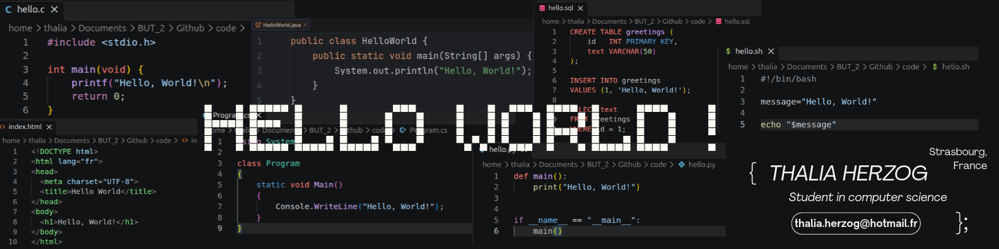

  

# Bienvenue ! 👋

  

Moi c’est **Thalia**, étudiante en BUT Informatique à **Strasbourg**.

Je suis passionnée par les langages bas niveau comme le *C*, mais aussi par la conception d’interfaces et l’**__expérience utilisateur (UX/UI)__**.

J’aime beaucoup les **échecs** et la logique.

Voici un aperçu de mes principaux projets réalisés au cours de ma première année d’études :

---

# Mes projets de première année

J’ai réalisé plusieurs projets en programmation : un jeu en **POO** inspiré d’*Inscryption*, un projet **Windows .NET** basé sur *Stargate*, une *bataille navale* en **assembleur** et une simulation de réseau local *(LAN)* en langage **C**.
<!--
- Projet en programmation orientée objet (POO) basé sur le jeu *Inscryption*  
- Projet Windows .NET Framework sur le thème de *Stargate*
- Projet en assembleur reproduisant une bataille navale.
- Projet en langage C simulant un petit réseau local (LAN).
-->

---

# Ma boîte à outils :

Chaque projet est une occasion d'apprendre quelque chose de nouveau. Voici les langages et les outils que j'ai appris à utiliser pour donner vie à mes idées. Clique sur une icône pour découvrir la doc ou installer l'outil !

### Langages de programmation

  
    
  
    
  
    
  
    
  
    
  
    
  

### Web

    
      
  
      
  

### Éditeurs et IDE

  
      
  
      
  
      
  

### Bases de données et frameworks

  
    
  
    
  

### Outils

  
    
  <a href="https://docs.github.com/fr">
    <picture>
      <source media="(prefers-color-scheme: dark)" srcset="https://cdn.simpleicons.org/github/white">
      
    </picture>
  </a>
    
  
    
  
    
  

---

# Welcome! 👋

  

I'm **Thalia**, a Computer Science student in the BUT program (Bachelor of Technology) in **Strasbourg**.

I'm passionate about low-level languages like *C*, as well as interface design and **__user experience (UX/UI)__**.

I really enjoy **chess** and logic.

Here's an overview of the main projects I completed during my first year of studies:

---

# My First-Year Projects

I completed several programming projects: an **OOP** game inspired by *Inscryption*, a **Windows .NET** project based on *Stargate*, a *Battleship* game in **assembly language**, and a local area network *(LAN)* simulation in **C**.

---

# My Toolbox

Every project is an opportunity to learn something new. Here are the languages and tools I've learned to use to bring my ideas to life. Click an icon to check out the docs or install the tool!

### Programming Languages

  
    
  
    
  
    
  
    
  
    
  
    
  

### Web

  
    
  
    
  

### Editors & IDEs

  
    
  
    
  
    
  

### Databases & Frameworks

  
    
  
    
  

### Tools

  
    
  <a href="https://docs.github.com/en">
    <picture>
      <source media="(prefers-color-scheme: dark)" srcset="https://cdn.simpleicons.org/github/white">
      
    </picture>
  </a>
    
  
    
  
    
  

